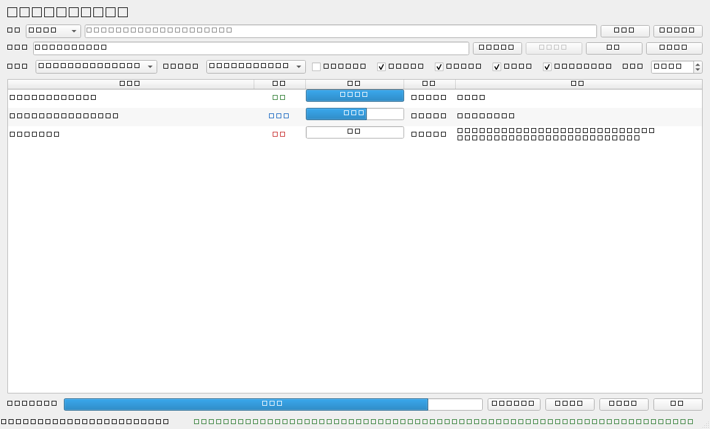

# QQ音乐音频转MP3

把 QQ 音乐解密后的普通音频（ogg / flac / m4a / wav / ape / wma / aac / opus / mp3 / aiff）批量转换为 MP3 的 Windows 桌面小工具。完全本地运行，不联网、不上传文件，转码由本机 FFmpeg 完成。



## 功能

- **单个文件 / 文件夹批量**转换，可勾选「包含子文件夹」递归扫描
- 三种输出位置：与源文件同目录、指定统一目录、指定目录并保留相对目录结构
- MP3 参数：VBR（`-q:a 2`，默认）/ CBR 128k / 192k / 256k / 320k
- 可选保留元数据、保留内嵌封面（失败自动去掉封面重试，不报错）
- 跳过已存在的 MP3（默认开启）、同名冲突策略（自动重命名 / 跳过 / 覆盖）
- 同批次里 `单曲.ogg` 与 `单曲.mp3` 这类同源主文件名会按策略处理，默认输出为 `单曲.mp3` 与 `单曲 (1).mp3`，不会互相覆盖
- 输入本身是 MP3 时默认直接复制
- 并发转换（默认 `min(4, CPU 核数)`，可调 1-8），`ffmpeg -progress pipe:1` 实时进度
- 开始 / 暂停（不再启动新任务）/ 继续 / 取消全部（终止 ffmpeg 子进程）
- 单个文件失败不影响其它文件，失败原因记录 ffmpeg stderr 最后 20 行
- 打开输出目录、导出日志、设置持久化、拖拽文件/文件夹添加任务、高 DPI、中文界面

## 目录结构

```
main.py         程序入口（高 DPI、日志、配置、主窗口）
ui_main.py      界面：主窗口、任务表格、设置对话框、拖拽
converter.py    FFmpeg 封装：命令构建、进度解析、并发执行、子进程管理
config.py       配置默认值与 %APPDATA%\QQAudio2MP3\config.json 持久化
utils.py        扩展名扫描、路径/耗时工具、日志初始化
selftest.py     核心逻辑自测（自动生成测试音频）
gui_selftest.py GUI 端到端自测
build.bat       PyInstaller 打包脚本
dist/           打包产物（QQAudio2MP3.exe）
_selftest/      自测生成的临时音频与输出（可删除）
_guitest/       GUI 自测生成的临时目录（可删除）
```

## 环境要求

- Windows 10/11（已在 Windows Server 2022 / 10.0.20348 验证）
- Python 3.11+（已在 3.12.10 验证）
- FFmpeg（需包含 `ffmpeg.exe` 与 `ffprobe.exe`，建议 gyan.dev 的 full build）

## 安装与运行

```powershell
python -m pip install -r requirements.txt
python main.py
```

启动时会从 PATH 自动探测 `ffmpeg.exe` 与 `ffprobe.exe`；探测不到则弹窗要求手动选择（同目录的 `ffprobe.exe` 会被自动识别）。之后可随时在「设置」中修改并持久化。

## 打包

```powershell
python -m pip install pyinstaller
pyinstaller --onefile --windowed --name QQAudio2MP3 main.py
```

或直接运行 `build.bat`（等价于上面的命令并清理中间文件）。产物在 `dist\QQAudio2MP3.exe`（约 45 MB，包含 PySide6 运行时）。

打包后不需要附带 FFmpeg，程序通过设置中的绝对路径调用它。

## 使用说明

1. 顶部选择「单个文件」或「文件夹批量」，点「浏览…」或直接把文件/文件夹拖进窗口。
2. 选择输出方式（同目录 / 统一目录 / 保留结构），需要时指定输出目录。
3. 中部设置码率、递归、跳过已存在、元数据、封面、并发数。
4. 点「开始转换」；表格实时显示状态、进度、耗时与信息。
5. 结束后可用「打开输出目录」查看结果，「导出日志」保存任务汇总与程序日志。

## 配置文件

位置：`%APPDATA%\QQAudio2MP3\config.json`（日志在 `%APPDATA%\QQAudio2MP3\logs\app.log`，2 MB 滚动，保留 3 份）。

持久化字段：

| 字段 | 说明 |
| --- | --- |
| `ffmpeg_path` / `ffprobe_path` | 可执行文件绝对路径 |
| `output_mode` | `same` / `custom` / `mirror` |
| `output_dir` | 统一输出目录 |
| `bitrate_mode` | `vbr` / `128` / `192` / `256` / `320` |
| `workers` | 并发数 1-8 |
| `recursive` / `skip_existing` | 递归、跳过已存在 |
| `keep_metadata` / `keep_cover` | 元数据、封面 |
| `copy_mp3` | 输入为 MP3 时直接复制 |
| `conflict_policy` | `rename` / `skip` / `overwrite` |
| `last_source` / `last_source_mode` | 上次选择 |

## FFmpeg 调用方式

参数列表形式，从不使用 `shell=True`；Windows 下 `creationflags=CREATE_NO_WINDOW` 避免黑框；子进程输出按 `utf-8 / errors="replace"` 解码。

VBR（默认）：

```
ffmpeg -hide_banner -nostdin -loglevel error -y -i "输入" -map 0:a:0 \
  -map 0:v:0? -c:v copy -disposition:v:0 attached_pic ... \
  -map_metadata 0 -metadata title=... -c:a libmp3lame -q:a 2 \
  -id3v2_version 3 -progress pipe:1 -nostats -f mp3 "输出.mp3.<任务ID>.part"
```

CBR 时将 `-q:a 2` 换成 `-b:a 192k`；不保留元数据时使用 `-map_metadata -1` 显式清空（否则 ffmpeg 默认会复制全局元数据）。转码先写入带任务 ID 的 `.part` 临时文件，成功后原子重命名为最终文件名，失败或取消时删除临时文件。

进度：先 `ffprobe -v error -show_entries format=duration -of default=nw=1:nk=1 "文件"` 取总时长，再解析 ffmpeg 的 `out_time_us=` 计算百分比；读取不到时长时显示「进行中」与速度。

## 常见问题

**Q：提示「找不到 ffmpeg」？**
在「设置」里选择 `ffmpeg.exe`；若同目录有 `ffprobe.exe` 会自动填入。也可把 FFmpeg 的 `bin` 加入 PATH。

**Q：转换出来没有元数据/封面？**

- OGG/Opus 的标签挂在音轨上，单纯 `-map_metadata 0` 会丢失，程序会额外用 ffprobe 读取标签并显式写入 `-metadata`。
- 封面以 MP3 附件图片形式写入，播放器支持情况不一；封面处理失败会自动去掉封面重试，不影响音频转换。
- 若仍缺失，检查对应选项是否勾选。

**Q：源文件是 MP3 却没生成新文件？**
默认「MP3 直接复制」会复制源文件到输出位置；如果目标路径与源文件相同则直接标记「跳过」。

**Q：同一文件夹里同时有 `歌曲.ogg` 和 `歌曲.mp3` 会怎样？**
两者都会输出为 `歌曲.mp3`，属于同名冲突。默认策略为「自动重命名」，第二个任务写成 `歌曲 (1).mp3`；选择「跳过」则第二个跳过，选择「覆盖」则后完成的任务覆盖先完成的任务。程序内部会给每个任务使用独立的 `.part` 临时文件，不会写坏文件。

**Q：某个文件失败了？**
该任务标记「失败」，信息列显示 ffmpeg stderr 最后 20 行，其余任务继续执行。可「导出日志」查看完整记录。

**Q：中文/空格路径有问题吗？**
不会。程序全程使用 `pathlib.Path` 和参数列表方式传参，已验证含中文、空格、方括号的路径。

**Q：为什么提示无法开始 / 缺少输出目录？**
输出方式为「指定统一输出目录」或「指定目录并保留目录结构」时必须先选择输出目录。

## 自测

```powershell
python selftest.py        # 核心逻辑：探针、单文件、批量递归、跳过、复制、取消、暂停、重命名、元数据/封面
python gui_selftest.py    # GUI 端到端：扫描、转换、跳过、拖拽、取消、关闭清理
```

自测会在 `_selftest/` 和 `_guitest/` 生成临时音频，可随时删除。`gui_selftest.py` 会短暂显示窗口；部分 PySide6 版本的 `offscreen` 插件在 Windows Server 上会崩溃，因此不要强制设置 `QT_QPA_PLATFORM=offscreen`。

### 本机实测结果

环境：Windows Server 2022（10.0.20348）、Python 3.12.10、PySide6 6.12.0、FFmpeg 8.1.1 full build。

| 验收项 | 结果 |
| --- | --- |
| 单个 `.ogg` 转 `.mp3`，ffprobe 可解析且时长正确 | 通过 |
| 文件夹批量 + 递归 + 保留目录结构 | 通过（7 个任务，6 个产物） |
| 跳过已存在 MP3 | 通过 |
| 中文、空格、方括号路径 | 通过 |
| 取消任务并终止 ffmpeg、清理 `.part` | 通过 |
| 损坏文件失败但不影响其他文件，记录 stderr | 通过 |
| 关闭窗口确认并清理子进程 | 通过（GUI 测试） |
| 保留元数据、保留内嵌封面 | 通过 |
| 并发、暂停/继续 | 通过 |
| `dist\QQAudio2MP3.exe` 启动并显示窗口 | 通过 |

- 核心自测：**16/16 通过**
- GUI 端到端：**11/11 通过**
